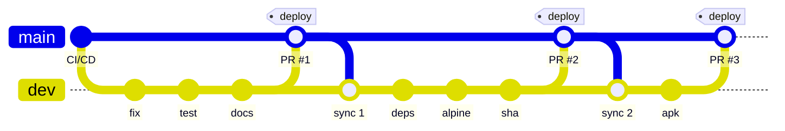

# Laboratorio 02: Implementación de un Entorno Colaborativo de Integración y Despliegue Continuo (CI/CD) para un Sistema Bancario

**Estudiante:** Mateo Vargas Tirado  
**Asignatura:** Arquitectura de Software  
**Institución:** Universidad de Antioquia  
**Semestre:** 2026-2  
**Fecha:** 13 de octubre de 2026    
**Repositorio:** [https://github.com/AraiGumaDev/back-lab02-banco2026-arqsoft-udea](https://github.com/AraiGumaDev/back-lab02-banco2026-arqsoft-udea)

---

## 1. Introducción

En el desarrollo de software moderno no basta con escribir código funcional: también es necesario garantizar que cada cambio se integre, pruebe, analice y despliegue de forma confiable y repetible. El enfoque **CI/CD** (Integración Continua, Entrega Continua y Despliegue Continuo) aborda este reto automatizando el ciclo de vida de la aplicación desde el *commit* hasta su ejecución en producción.

El presente informe documenta la construcción de un pipeline CI/CD para el backend **Banco 2026** desarrollado en el Laboratorio 1 (API REST en Spring Boot con arquitectura en capas). Sobre este proyecto se integraron las plataformas **GitHub Actions** para la automatización del pipeline, **JaCoCo** y **SonarCloud** para la medición de cobertura y calidad del código, **Docker Hub** para la publicación de la imagen de contenedor, **Render** junto con **Aiven MySQL** para el despliegue en la nube, y **Snyk** para el análisis de vulnerabilidades. Además, se aplicó la estrategia de ramificación **Trunk-Based Development**, integrando los cambios a la rama principal mediante *pull requests*.

---

## 2. Objetivos

### 2.1. Objetivo General
Implementar un pipeline de integración y despliegue continuo para el backend Banco 2026 que automatice la ejecución de pruebas, el análisis de calidad y seguridad, la construcción del artefacto y su despliegue en un proveedor de nube.

### 2.2. Objetivos Específicos
* **Automatizar las pruebas:** Configurar un flujo de trabajo en GitHub Actions que ejecute las pruebas unitarias en cada *push* y *pull request*.
* **Medir la calidad y cobertura:** Integrar JaCoCo y SonarCloud para obtener métricas de cobertura, *code smells*, *bugs*, vulnerabilidades y *security hotspots*.
* **Generar el artefacto:** Construir el JAR de la aplicación y publicarlo como artefacto del pipeline.
* **Contenerizar la aplicación:** Crear una imagen Docker y publicarla automáticamente en Docker Hub.
* **Desplegar en la nube:** Desplegar el contenedor en Render, conectado a una base de datos MySQL gestionada en Aiven.
* **Aplicar Trunk-Based Development:** Integrar los cambios a `main` con frecuencia, mediante *pull requests* pequeños desde una rama de integración y validados por el pipeline.
* **Analizar la seguridad de dependencias:** Escanear el proyecto con Snyk para identificar vulnerabilidades conocidas.

---

## 3. Herramientas y Plataformas Empleadas

| Categoría | Herramienta / Plataforma | Uso en el laboratorio |
|---|---|---|
| **Aplicación base** | Spring Boot 4.1.1 / Java 17 | Backend REST Banco 2026 (Laboratorio 1). |
| **Control de versiones** | Git, GitHub y GitKraken | Repositorio central, ramas, *pull requests* y visualización del historial. |
| **Automatización CI/CD** | GitHub Actions | Ejecución del pipeline (pruebas, análisis, build, imagen y despliegue). |
| **Pruebas** | JUnit 5, Mockito, Spring Test, H2 | Pruebas unitarias y de integración sin depender de MySQL. |
| **Cobertura** | JaCoCo | Medición del porcentaje de código cubierto por las pruebas. |
| **Calidad de código** | SonarCloud | Análisis estático: *bugs*, *code smells*, vulnerabilidades, *hotspots* y Quality Gate. |
| **Contenedores** | Docker y Docker Hub | Empaquetado de la aplicación en una imagen y registro público de la misma. |
| **Nube (cómputo)** | Render | Ejecución del contenedor como Web Service. |
| **Nube (base de datos)** | Aiven for MySQL | Base de datos MySQL gestionada para el entorno desplegado. |
| **Seguridad** | Snyk | Detección de vulnerabilidades en dependencias. |
| **Pruebas de API** | Bruno / Swagger UI | Verificación de los endpoints desplegados en la nube. |
| **Base de datos (cliente)** | DBeaver | Consulta directa de los datos persistidos en Aiven. |

---

## 4. Procedimiento

### Paso 0: Preparación del Repositorio de Trabajo

Para el laboratorio se creó un nuevo repositorio en GitHub, **`back-lab02-banco2026-arqsoft-udea`**, a partir de una copia del backend del Laboratorio 1. De esta forma, el historial de commits original se conserva y el nuevo trabajo de CI/CD queda separado de la entrega anterior. El repositorio se clonó localmente con **GitKraken**.


Antes de construir el pipeline se corrigieron algunos aspectos de configuración del repositorio que afectarían la ejecución en GitHub Actions:

1. **Creación del archivo `.gitignore`:** Se creó uno nuevo que excluye la carpeta `target/`, los archivos de los IDE (`.idea/`, `*.iml`, `.vscode/`), los artefactos empaquetados (`*.jar`) y, en especial, los archivos de variables de entorno (`.env`, `*.env`), para que las credenciales nunca se suban al repositorio.

2. **Creación del archivo `.gitattributes`:** Los *runners* de GitHub Actions usan Linux. Si el script `mvnw` llega con finales de línea de Windows (CRLF), falla con el error `/bin/sh^M: bad interpreter`. Por eso se definió que `mvnw` y los `*.sh` siempre usen LF, que los `*.cmd` usen CRLF y que las imágenes y los JAR se traten como binarios.
   ```gitattributes
   * text=auto
   mvnw text eol=lf
   *.sh text eol=lf
   *.cmd text eol=crlf
   *.png binary
   ```

3. **Permiso de ejecución del Maven Wrapper:** El archivo `mvnw` estaba registrado en Git con modo `100644` (no ejecutable), lo que en Linux produciría un error `Permission denied`. Se corrigió con:
   ```bash
   git update-index --chmod=+x mvnw
   ```
   Así el archivo queda con modo `100755`.

4. **Nuevo `README.md`:** Se reemplazó el informe del Laboratorio 1 por un README propio del Laboratorio 2. Contiene la descripción de la aplicación, la estructura de carpetas, las instrucciones de instalación, prueba y cobertura, y un espacio para las insignias (*badges*) de cada plataforma integrada. El detalle del proceso queda en este informe (`INFORME-LAB2.md`).

Finalmente, se registraron los cambios y se subieron a la rama `main`:
```bash
git add .gitignore .gitattributes README.md mvnw
git commit -m "chore: Preparación del repositorio para el laboratorio 2 (CI/CD)"
git push origin main
```

### Paso 1: Preparación de la Aplicación para la Integración Continua y la Nube

El laboratorio de referencia usa una aplicación sencilla sin base de datos, con datos generados por Faker. El backend Banco 2026, en cambio, depende de **MySQL**. Esto genera dos problemas que hay que resolver antes de construir el pipeline:

1. **Las pruebas no son portables.** La única prueba del Laboratorio 1 (`contextLoads`) levanta el contexto completo de Spring y se conecta a `localhost:3306`. En local pasaba porque había un MySQL corriendo, pero en el *runner* de GitHub Actions no existe ese servidor y la prueba fallaría.
2. **La configuración no es apta para la nube.** La URL de la base de datos estaba escrita directamente en el código y el puerto estaba fijo en `8080`.

#### 1.1. Base de datos en memoria H2 para las pruebas

Se agregaron al `pom.xml` las dependencias de prueba **H2** (base de datos en memoria) y **Spring Security Test** (para simular credenciales en las pruebas):

```xml
<dependency>
    <groupId>org.springframework.boot</groupId>
    <artifactId>spring-boot-starter-security-test</artifactId>
    <scope>test</scope>
</dependency>
<dependency>
    <groupId>com.h2database</groupId>
    <artifactId>h2</artifactId>
    <scope>test</scope>
</dependency>
```

Se creó el archivo `src/test/resources/application.properties`. Durante las pruebas, este archivo **reemplaza** al de `src/main/resources` y apunta a una base H2 en modo compatible con MySQL. Además, define contraseñas conocidas para los usuarios en memoria:

```properties
spring.datasource.url=jdbc:h2:mem:banco2026;MODE=MySQL;DATABASE_TO_LOWER=TRUE;DB_CLOSE_DELAY=-1
spring.datasource.driver-class-name=org.h2.Driver
spring.jpa.hibernate.ddl-auto=create-drop
USER_PASSWORD=user-test
ADMIN_PASSWORD=admin-test
```

Con esto las pruebas se ejecutan igual en cualquier máquina, sin servicios externos, que es una condición necesaria para la integración continua.

#### 1.2. Configuración externalizada (Twelve-Factor App)

El archivo `src/main/resources/application.properties` se modificó para que todos los valores que dependen del entorno se lean desde **variables de entorno**. Cada una tiene un valor por defecto para desarrollo local:

| Propiedad | Variable de entorno | Valor por defecto (local) |
|---|---|---|
| `server.port` | `PORT` | `8080` |
| `spring.datasource.url` | `APP_DB_URL` | `jdbc:mysql://localhost:3306/banco2026?...` |
| `spring.datasource.username` | `APP_DB_USER` | `banco_user` |
| `spring.datasource.password` | `APP_DB_PASSWORD` | `user123` |
| `spring.jpa.show-sql` | `SHOW_SQL` | `false` |
| `logging.level.org.hibernate.SQL` | `SQL_LOG_LEVEL` | `INFO` |

Así, el mismo artefacto (JAR o imagen Docker) se puede ejecutar en local, en el pipeline o en Render cambiando solo las variables de entorno, sin recompilar. También se hicieron estos ajustes:
* Se eliminó la propiedad `spring.jpa.database-platform`, porque Hibernate 7 detecta el dialecto automáticamente y advertía que era innecesaria.
* Se quitó el log `TRACE` de los parámetros SQL, ya que en producción podría exponer datos sensibles (saldos, cuentas).
* Se desactivó `spring.jpa.open-in-view`, una buena práctica para APIs REST.

#### 1.3. Nombre fijo del artefacto

En el `pom.xml` se agregó `<finalName>banco2026</finalName>` dentro de `<build>`. Así, el JAR generado siempre se llama `target/banco2026.jar`, sin importar la versión, y los siguientes pasos del pipeline (subida del artefacto y Dockerfile) pueden referenciarlo con una ruta conocida.

#### 1.4. Pruebas unitarias y de integración

Para que la medición de cobertura con JaCoCo y SonarCloud sea significativa, se escribieron **41 pruebas nuevas** (42 con `contextLoads`), organizadas en tres clases:

| Clase de prueba | Tipo | Pruebas | Qué valida |
|---|---|---|---|
| `service/CustomerServiceTest` | Unitaria (JUnit 5 + Mockito) | 9 | Listar, consultar, crear, actualizar parcial y totalmente, y eliminar clientes; excepción `ResourceNotFoundException` cuando el cliente no existe. |
| `service/TransactionServiceTest` | Unitaria (JUnit 5 + Mockito) | 22 | Transferencia exitosa y sus validaciones (cuentas nulas o inexistentes, saldo insuficiente); consultas; actualización del monto en ambos sentidos y validación de cuentas; anulación con reversión de saldos. |
| `controller/BancoApiIntegrationTest` | Integración (`@SpringBootTest` + MockMvc + H2) | 10 | Flujo HTTP completo: Swagger público, `401` sin credenciales o con clave errónea, `403` cuando `USER` intenta escribir, CRUD de clientes, flujo completo de transferencia → actualización → anulación verificando saldos, y respuestas `400`/`404` del `GlobalExceptionHandler`. |
| `Banco2026ApplicationTests` | Smoke test | 1 | El contexto de Spring arranca correctamente (ahora sobre H2). |

En las pruebas unitarias se usan *mocks* de los repositorios, pero los **mappers reales generados por MapStruct** (`Mappers.getMapper(...)`), para validar también la conversión entidad ↔ DTO. Las pruebas de integración ejercitan la cadena completa *SecurityFilterChain → Controller → Service → Repository → H2*, con autenticación HTTP Basic simulada por `SecurityMockMvcRequestPostProcessors.httpBasic(...)`.

> **Hallazgo durante las pruebas:** Al escribir las pruebas de `updateTransactionById` se encontró que las validaciones de saldo están invertidas. Cuando el monto **aumenta**, el método no verifica que el remitente tenga saldo suficiente para la diferencia, y cuando **disminuye**, no verifica que el destinatario pueda devolverla. Los saldos se recalculan correctamente, pero alguna de las cuentas podría quedar en negativo. El defecto se corrigió más adelante en la rama `dev`, aplicando el flujo de *pull request* (ver Paso 7.3).

#### 1.5. Verificación local

Se ejecutó el ciclo completo de Maven:
```bash
./mvnw clean verify
```
```text
[INFO] Tests run: 1,  Failures: 0, Errors: 0, Skipped: 0 -- in Banco2026ApplicationTests
[INFO] Tests run: 10, Failures: 0, Errors: 0, Skipped: 0 -- in controller.BancoApiIntegrationTest
[INFO] Tests run: 9,  Failures: 0, Errors: 0, Skipped: 0 -- in service.CustomerServiceTest
[INFO] Tests run: 22, Failures: 0, Errors: 0, Skipped: 0 -- in service.TransactionServiceTest
[INFO] Tests run: 42, Failures: 0, Errors: 0, Skipped: 0
[INFO] BUILD SUCCESS
```
En los logs se confirma que las pruebas usan `jdbc:h2:mem:banco2026` y no MySQL. Se generó el artefacto `target/banco2026.jar`. Al ejecutarlo con `java -jar target/banco2026.jar`, la aplicación arrancó contra el MySQL local con los valores por defecto: `/v3/api-docs` respondió `200` y `/api/customers` sin credenciales respondió `401`.


### Paso 2: Creación del Pipeline en GitHub Actions (Job de Pruebas)

**GitHub Actions** es la plataforma de automatización integrada en GitHub. Permite definir *workflows* en archivos YAML dentro de la carpeta `.github/workflows/`, y GitHub los ejecuta en máquinas virtuales (*runners*) cada vez que ocurre un evento en el repositorio. El primer bloque del pipeline consiste en ejecutar automáticamente las pruebas con cada cambio, que es la base de la **Integración Continua**.

#### 2.1. Archivo `.github/workflows/build.yml`

```yaml
name: CI/CD Pipeline

on:
  workflow_dispatch:
  push:
    branches:
      - main
  pull_request:
    branches:
      - main

jobs:
  tests:
    name: Unit tests
    runs-on: ubuntu-latest
    steps:
      - name: Checkout
        uses: actions/checkout@v5

      - name: Set up JDK 17
        uses: actions/setup-java@v5
        with:
          distribution: temurin
          java-version: '17'
          cache: maven

      - name: Run Tests
        run: mvn -B test
```

Elementos principales del archivo:

* **`name`**: nombre del workflow que aparece en la pestaña *Actions*.
* **`on`**: eventos que disparan el workflow.
  * `workflow_dispatch`: permite lanzarlo manualmente desde la interfaz de GitHub.
  * `push` a `main`: se ejecuta con cada cambio integrado a la rama principal.
  * `pull_request` hacia `main`: valida los cambios **antes** de integrarlos. Es lo que se necesita para el flujo *trunk-based* del Paso 7.
* **`jobs`**: trabajos del pipeline. Cada uno corre en una máquina virtual nueva y aislada. Por ahora hay un único job, `tests` (etiqueta *Unit tests*).
* **`runs-on: ubuntu-latest`**: sistema operativo del *runner*.
* **`steps`**: tareas individuales del job.
  1. `actions/checkout@v5` descarga el código del repositorio en el *runner*.
  2. `actions/setup-java@v5` instala el **JDK 17 Temurin**, la misma versión que declara el `pom.xml` (`<java.version>17</java.version>`). Con `cache: maven` guarda en caché el repositorio local de Maven (`~/.m2`) usando como clave el *hash* del `pom.xml`, lo que acelera las ejecuciones siguientes.
  3. `mvn -B test` ejecuta las 42 pruebas en modo *batch* (no interactivo).

#### 2.2. Ejecución del pipeline

Se subió el archivo al repositorio:
```bash
git add .github/workflows/build.yml README.md
git commit -m "ci: agrega pipeline de GitHub Actions con job de pruebas"
git push origin main
```

El *push* a `main` disparó automáticamente el workflow. En la pestaña **Actions** del repositorio se puede ver el estado de la ejecución y el log de cada paso.


#### 2.3. Insignia (badge) de estado

Desde la vista del workflow, en el menú **(…) → Create status badge**, se obtuvo el Markdown de la insignia y se agregó al inicio del `README.md`:

```markdown
[](https://github.com/AraiGumaDev/back-lab02-banco2026-arqsoft-udea/actions/workflows/build.yml)
```

La insignia muestra en tiempo real si la última ejecución del pipeline en `main` fue exitosa (*passing*) o falló (*failing*).


### Paso 3: Cobertura de Código con JaCoCo y Análisis de Calidad con SonarCloud

**SonarCloud** es la versión en la nube de SonarQube: un servicio de **análisis estático de código** que inspecciona el código fuente sin ejecutarlo, en busca de:
* **Bugs:** errores que afectan la fiabilidad del programa.
* **Vulnerabilidades:** debilidades que un tercero podría explotar.
* **Code Smells:** características que no rompen el funcionamiento, pero afectan la mantenibilidad (código duplicado, complejidad, malas prácticas).
* **Security Hotspots:** fragmentos sensibles a la seguridad que un humano debe revisar. Pueden resultar falsos positivos.

Cada análisis se evalúa contra un **Quality Gate**, un conjunto de condiciones mínimas (por ejemplo, cobertura del código nuevo ≥ 80% y cero bugs nuevos) que determinan si el código está listo para integrarse.

**JaCoCo** (*Java Code Coverage*) instrumenta el *bytecode* durante las pruebas y mide qué instrucciones, líneas y ramas se ejecutaron. SonarCloud no ejecuta las pruebas: lee el reporte XML de JaCoCo para mostrar la cobertura.

#### 3.1. Configuración del proyecto en SonarCloud

1. Se inició sesión en [sonarcloud.io](https://sonarcloud.io) con la cuenta de GitHub y se importó la organización `araigumadevprojects`.
2. Con **Analyze new project** se seleccionó el repositorio `back-lab02-banco2026-arqsoft-udea` y se pulsó **Set Up**.
3. En **Set up project for Clean as You Code** se definió el código nuevo como **Number of days = 1**, para que el análisis se enfoque en los cambios del último día.
4. En **Choose your Analysis Method** se seleccionó **With GitHub Actions**. El *Automatic Analysis* quedó desactivado (*Administration → Analysis Method*), porque ese modo analiza el código por su cuenta pero **no puede recibir la cobertura de JaCoCo**. El análisis debe ejecutarlo el pipeline después de correr las pruebas.
5. SonarCloud generó un token de acceso. En GitHub (*Settings → Secrets and variables → Actions → New repository secret*) se creó el secreto **`SONAR_TOKEN`** con ese valor. Al guardarlo como secreto, el token nunca aparece en el código ni en los logs.
6. En **Information** del proyecto se obtuvieron el **Project Key** y la **Organization Key**.


#### 3.2. Plugin de JaCoCo en el `pom.xml`

```xml
<plugin>
    <groupId>org.jacoco</groupId>
    <artifactId>jacoco-maven-plugin</artifactId>
    <version>${jacoco.version}</version> <!-- 0.8.14 -->
    <executions>
        <execution>
            <goals>
                <goal>prepare-agent</goal>
            </goals>
        </execution>
        <execution>
            <id>report</id>
            <phase>test</phase>
            <goals>
                <goal>report</goal>
            </goals>
        </execution>
    </executions>
</plugin>
```
* `prepare-agent` configura el agente de JaCoCo en la propiedad `argLine`, que Surefire usa al lanzar la JVM de pruebas.
* `report` genera, en la fase `test`, el reporte en `target/site/jacoco/` (`index.html` para verlo en el navegador y `jacoco.xml` para SonarCloud).

La guía usa JaCoCo 0.8.10. Aquí se usó la **0.8.14**, porque las versiones antiguas no soportan el *bytecode* de los JDK recientes (en local se ejecuta con JDK 21).

> **Problema encontrado y solución:** El `pom.xml` del Laboratorio 1 tenía en `maven-surefire-plugin` un `<argLine>` fijo (`-Djdk.net.URLClassPath.disableClassPathURLCheck=true`). Este valor **sobrescribe** el `argLine` que configura JaCoCo, así que el agente nunca se adjuntaría y la cobertura saldría en **0%**, justo el síntoma que describe la guía. Se corrigió con la sintaxis de evaluación tardía `@{argLine}`, que concatena el agente de JaCoCo con el parámetro existente. También se declaró una propiedad `<argLine></argLine>` vacía, para que la expresión nunca quede indefinida:
> ```xml
> <argLine>@{argLine} -Djdk.net.URLClassPath.disableClassPathURLCheck=true</argLine>
> ```

Además, se creó el archivo `lombok.config` con `lombok.addLombokGeneratedAnnotation = true`. Así Lombok marca con `@Generated` el código que genera (getters, setters, `equals`, `hashCode`, `toString`), y JaCoCo y SonarCloud lo excluyen de la medición. Ese código no lo escribe el desarrollador y solo distorsionaba la métrica de ramas.

#### 3.3. Cobertura obtenida en local

```bash
./mvnw clean verify
# Reporte: target/site/jacoco/index.html
```

| Métrica | Sin `lombok.config` | Con `lombok.config` |
|---|---|---|
| Instrucciones | 83,6 % | **97,3 %** |
| Líneas | 94,7 % | **95,7 %** |
| Ramas | 36,9 % | **81,6 %** |

Las ramas que quedan sin cubrir corresponden a las validaciones nulas internas de los mappers generados por MapStruct y a dos validaciones de saldo de `updateTransactionById` que hoy **no se pueden alcanzar**, por el defecto descrito en el Paso 1.


#### 3.4. Propiedades de SonarCloud y job `sonar` en el pipeline

En la sección `<properties>` del `pom.xml`:
```xml
<sonar.projectKey>araigumadevprojects_lab02-banco2026-arqsoft-udea</sonar.projectKey>
<sonar.organization>araigumadevprojects</sonar.organization>
<sonar.host.url>https://sonarcloud.io</sonar.host.url>
```

En `build.yml` se agregó el job `sonar`:
```yaml
  sonar:
    name: SonarCloud analysis
    needs: tests
    runs-on: ubuntu-latest
    permissions:
      contents: read
      pull-requests: read
    steps:
      - name: Checkout
        uses: actions/checkout@v5
        with:
          fetch-depth: 0

      - name: Set up JDK 17
        uses: actions/setup-java@v5
        with:
          distribution: temurin
          java-version: '17'
          cache: maven

      - name: Cache SonarCloud packages
        uses: actions/cache@v4
        with:
          path: ~/.sonar/cache
          key: ${{ runner.os }}-sonar
          restore-keys: ${{ runner.os }}-sonar

      - name: Build, test and analyze
        env:
          SONAR_TOKEN: ${{ secrets.SONAR_TOKEN }}
          GITHUB_TOKEN: ${{ secrets.GITHUB_TOKEN }}
        run: mvn -B verify org.sonarsource.scanner.maven:sonar-maven-plugin:sonar
```
* **`needs: tests`**: el análisis solo se ejecuta si las pruebas pasaron. Si `tests` falla, `sonar` se omite.
* **`fetch-depth: 0`**: descarga todo el historial de Git. SonarCloud lo necesita para saber qué código es "nuevo" y a quién atribuir cada *issue*.
* **`mvn verify ... sonar:sonar`**: compila, ejecuta las pruebas, genera `jacoco.xml` y envía todo a SonarCloud en un solo paso. El *projectKey*, la *organization* y el *host* se leen del `pom.xml`, así que no se repiten en el YAML como en la guía.
* **`SONAR_TOKEN`** se toma de los secretos del repositorio. **`GITHUB_TOKEN`** lo provee GitHub automáticamente y permite a SonarCloud decorar los *pull requests* con el resultado del análisis.


#### 3.5. Resultados en SonarCloud

El primer *push* ejecutó los dos jobs (`tests` → `sonar`) correctamente en GitHub Actions.

**Problema encontrado: la rama principal registrada como `master`.** Al crear el proyecto, SonarCloud registra la rama principal con el nombre por defecto `master`. Como el repositorio usa `main`, el primer análisis quedó como una rama secundaria (`main`, tipo *short-lived*, que "se fusiona en `master`"), mientras la rama principal `master` quedaba vacía. Las insignias del README consultan la rama principal, así que mostraban *"Quality Gate not computed"* y *"Measure has not been found"*. Se diagnosticó con la API pública de SonarCloud:
```bash
curl "https://sonarcloud.io/api/project_branches/list?project=araigumadevprojects_lab02-banco2026-arqsoft-udea"
# main   -> isMain: false, type: SHORT, mergeBranch: master, coverage 96%
# master -> isMain: true,  type: LONG,  sin análisis
```
**Solución:** en *Administration → Branches and Pull Requests* se eliminó la rama secundaria `main`, se renombró la rama principal `master` a `main` y se relanzó el pipeline manualmente (*Run workflow*, gracias al disparador `workflow_dispatch`).

**Resultados del primer análisis completo de `main`:**

| Dimensión | Resultado | Calificación |
|---|---|---|
| Cobertura | **96,0 %** | — |
| Líneas de código | 763 | — |
| Duplicación | 0,0 % | — |
| Reliability (bugs) | 0 bugs | **A** |
| Maintainability (code smells) | 16 | **A** |
| Security (vulnerabilidades) | 1 | **D** |
| Dependency risks | 18 | **C** |
| Quality Gate | *Not computed* | — |

> El Quality Gate aparece como *not computed* porque, tras renombrar la rama, `main` todavía no tenía un **período de código nuevo** de referencia (la API devuelve `"periods": []`). El Quality Gate de SonarCloud evalúa las condiciones sobre el código nuevo, así que se calcula desde el siguiente análisis.


#### 3.6. Análisis y corrección de los issues

Se revisaron los 17 *issues* reportados, aplicando el criterio que propone la guía: aceptar la sugerencia y refactorizar, o justificar el caso como seguro o falso positivo.

**a) Vulnerabilidad: "Make sure disabling Spring Security's CSRF protection is safe here" (`java:S4502`, crítica).**
CSRF (*Cross-Site Request Forgery*) es un ataque en el que un sitio malicioso hace que el navegador de la víctima envíe una petición a otra aplicación, aprovechando que el navegador **adjunta automáticamente la cookie de sesión**. En esta API la protección CSRF se puede deshabilitar de forma segura porque:
* La política de sesión es `STATELESS`: el servidor no crea sesiones ni emite cookies de sesión.
* La autenticación es HTTP Basic: el cliente debe enviar explícitamente la cabecera `Authorization` en **cada** petición. Un sitio de terceros no puede forjar esa cabecera.
* Es una API REST consumida por clientes programáticos (*frontend*, Bruno, Postman), no un formulario HTML con sesión.

Activar CSRF obligaría a enviar un *token* CSRF en cada `POST/PUT/DELETE` sin aportar protección real en este escenario. Por eso se mantuvo la configuración, se documentó la decisión con un comentario en `SecurityConfig` y el *issue* se marcó en SonarCloud como **Accepted / Safe**, con esta justificación.

**b) Inyección por campo: "Remove this field injection and use constructor injection instead" (`java:S6813`, 3 issues).**
`TransactionService` usaba `@Autowired` sobre los atributos. Se cambió a **inyección por constructor** con atributos `final`, que es la práctica que recomienda Spring:
```java
private final TransactionRepository transactionRepository;
private final CustomerRepository customerRepository;
private final TransactionMapper transactionMapper;

public TransactionService(TransactionRepository transactionRepository, CustomerRepository customerRepository,
                          TransactionMapper transactionMapper) { ... }
```
Ventajas: las dependencias son obligatorias e inmutables, la clase se puede instanciar en pruebas sin Spring y las dependencias quedan explícitas. Ahora `CustomerService` y `TransactionService` siguen el mismo patrón.

**c) Otros *code smells* corregidos:**

| Regla | Issue | Corrección |
|---|---|---|
| `java:S1192` | Literales duplicados (`"/api/**"`, `"ADMIN"`, `"Sender Account Number not found"`, `"Receiver Account Number not found"`, `"Transaction not found"`) | Constantes `API_PATTERN`, `ROLE_ADMIN`, `ROLE_USER`, `SENDER_NOT_FOUND`, `RECEIVER_NOT_FOUND`, `TRANSACTION_NOT_FOUND`. |
| `java:S112` / `java:S1130` | `securityFilterChain(...) throws Exception` declara una excepción genérica que no se lanza | Se eliminó el `throws Exception`. En Spring Security 7, `HttpSecurity.build()` ya no declara excepciones verificadas. |
| `java:S8688` | `LocalDateTime.now()` sin zona horaria | `LocalDateTime.now(ZONE)` con `ZoneId.of("America/Bogota")`. Es importante porque el servidor en la nube corre en UTC. |
| `java:S6204` | `collect(Collectors.toList())` | `Stream.toList()`. |
| `java:S3457` | `String.format` sin especificadores | Se retorna el literal directamente. |
| `java:S1186` | Constructor vacío sin explicación en `TransferRequestDTO` | Comentario que indica que lo requiere Jackson. |
| `java:S120` | Paquete `DTO` en mayúsculas | Se renombró a `dto` con `git mv` en dos pasos (`DTO → dto_tmp → dto`), porque Windows no distingue mayúsculas en los nombres de carpeta. |

**d) Riesgos en dependencias (18, calificación C).**
El proyecto usaba `springdoc-openapi-starter-webmvc-ui` **2.8.5**, la línea de springdoc para Spring Boot 3, que arrastra dependencias transitivas con vulnerabilidades conocidas. Como el proyecto usa **Spring Boot 4**, se actualizó a la línea compatible **3.1.1**.

Tras los cambios, las 42 pruebas siguen pasando y la cobertura local se mantiene (97,3 % de instrucciones, 95,8 % de líneas).

**Resultado del segundo análisis (después de las correcciones):**

| Dimensión | Primer análisis | Después de las correcciones |
|---|---|---|
| Quality Gate | *Not computed* | ✅ **Passed** |
| Cobertura | 96,0 % | 96,0 % (código nuevo: **100 %**) |
| Reliability | A (0 bugs) | **A** (0 bugs) |
| Security | **D** (1 vulnerabilidad) | **A** (0 vulnerabilidades) |
| Maintainability | A (16 code smells) | **A** (1 code smell*) |
| Duplicación | 0,0 % | 0,0 % |
| Security Hotspots | 0 | 0 |

\* El *code smell* restante (`java:S1186`, constructor vacío de `TransferRequestDTO`) correspondía a un cambio que no alcanzó a entrar en el *commit* de las correcciones; se incluyó en el siguiente.

Se cumplieron todas las condiciones del Quality Gate *Sonar way*: calificaciones de confiabilidad, seguridad y mantenibilidad del código nuevo iguales a A, cobertura del código nuevo ≥ 80 % (se obtuvo 100 %) y duplicación por debajo del umbral.


#### 3.7. Insignias de SonarCloud

Desde **Information → Badges** se copiaron al `README.md` las insignias de *Quality Gate Status*, *Coverage*, *Bugs* y *Code Smells*.


### Paso 4: Construcción del Artefacto JAR

Después de validar el código con las pruebas (`tests`) y el análisis de calidad (`sonar`), el pipeline construye el **artefacto desplegable**: el JAR ejecutable de Spring Boot, que contiene la aplicación y todas sus dependencias. Este es el primer paso de la **Entrega Continua**: cada cambio que supera las validaciones produce un artefacto listo para desplegar.

#### 4.1. Job `build`

```yaml
  build:
    name: Build
    needs: sonar
    runs-on: ubuntu-latest
    steps:
      - name: Checkout
        uses: actions/checkout@v5

      - name: Set up JDK 17
        uses: actions/setup-java@v5
        with:
          distribution: temurin
          java-version: '17'
          cache: maven

      - name: Build with Maven
        run: mvn -B package -DskipTests --file pom.xml

      - name: Upload JAR
        uses: actions/upload-artifact@v5
        with:
          name: banco2026-jar
          path: target/banco2026.jar
          if-no-files-found: error
          retention-days: 7
```

* **`needs: sonar`**: el JAR solo se construye si el análisis de SonarCloud terminó bien, que a su vez depende de las pruebas. Esto encadena las etapas **tests → sonar → build**: si una etapa falla, las siguientes no se ejecutan y nunca se genera un artefacto a partir de código que no pasó las validaciones.
* **`mvn -B package -DskipTests`**: compila y empaqueta. Las pruebas se omiten porque ya se ejecutaron en los jobs anteriores y repetirlas solo alargaría el pipeline.
* **`actions/upload-artifact`**: publica el archivo como **artefacto del workflow**. Así queda disponible para descargarlo desde la página de la ejecución y para que otros jobs lo usen. Gracias al `<finalName>banco2026</finalName>` del Paso 1, la ruta `target/banco2026.jar` es fija.
  * `if-no-files-found: error` hace fallar el job si el JAR no se generó, en lugar de continuar en silencio.
  * `retention-days: 7` limita cuánto tiempo GitHub guarda el artefacto, para no consumir la cuota de almacenamiento.

#### 4.2. Ejecución

Al hacer *push* a `main`, el pipeline ejecuta los tres jobs en secuencia. Al final, en la sección **Artifacts** de la ejecución aparece el archivo `banco2026-jar`, que se puede descargar.


### Paso 5: Imagen Docker y Publicación en Docker Hub

**Docker** empaqueta la aplicación junto con su entorno de ejecución (sistema base, JRE, configuración) en una **imagen** inmutable, que se ejecuta igual en cualquier máquina con Docker: el portátil del desarrollador, el *runner* de CI o el proveedor de nube. **Docker Hub** es el registro público donde se almacenan y distribuyen esas imágenes. Desde ahí, el proveedor de nube del Paso 6 descargará la imagen para desplegarla.

#### 5.1. Configuración en Docker Hub y GitHub

1. En [hub.docker.com](https://hub.docker.com) se creó el repositorio público **`mateovargast/banco2026`**. 
2. En *Account settings → Personal access tokens* se generó un **Access Token** con permisos *Read & Write*. Se usa un token en lugar de la contraseña de la cuenta porque se puede revocar en cualquier momento sin cambiar la contraseña y tiene permisos limitados.
3. En el repositorio de GitHub (*Settings → Secrets and variables → Actions*) se crearon los secretos:
   * `DOCKER_USERNAME`: usuario de Docker Hub.
   * `DOCKER_PASSWORD`: el Access Token.


#### 5.2. Dockerfile

```dockerfile
FROM eclipse-temurin:17-jre-jammy

WORKDIR /app

RUN groupadd --system spring && useradd --system --gid spring spring

COPY target/banco2026.jar app.jar
RUN chown spring:spring app.jar
USER spring

ENV JAVA_TOOL_OPTIONS="-XX:MaxRAMPercentage=75.0"

EXPOSE 8080

ENTRYPOINT ["java", "-jar", "app.jar"]
```

> **Nota:** Esta es la versión inicial del Dockerfile. En el Paso 8 se cambió la imagen base a `eclipse-temurin:17-jre-alpine` y se agregó `RUN apk upgrade --no-cache`, para reducir las vulnerabilidades que reportó Snyk.

* **`eclipse-temurin:17-jre-jammy`**: imagen base con solo el **JRE** 17 (sin compilador), que es más liviana y tiene menos superficie de ataque que una con JDK completo.
* **Usuario `spring` sin privilegios**: el proceso no se ejecuta como `root` dentro del contenedor. Es una buena práctica de seguridad (si la aplicación se viera comprometida, el atacante no tendría privilegios de administrador en el contenedor) y es una de las recomendaciones que revisan herramientas como Snyk.
* **`COPY target/banco2026.jar`**: la imagen se construye a partir del **artefacto JAR que generó el job `build`** (Paso 4), no recompilando el código fuente.
* **`JAVA_TOOL_OPTIONS=-XX:MaxRAMPercentage=75.0`**: la JVM dimensiona el *heap* según la memoria asignada al contenedor. Esto es importante en planes de nube con poca RAM, como el gratuito de Render con 512 MB.
* **`EXPOSE 8080`**: documenta el puerto de la aplicación. En la nube se puede cambiar con la variable `PORT` (Paso 1).

Se agregó un `.dockerignore` que excluye todo excepto `target/banco2026.jar`. Así el contexto que se envía al motor de Docker es mínimo y no incluye por error archivos como `.env` o `.git`.

> **Diferencias con la guía:** La guía usa un Dockerfile *multi-stage* que vuelve a compilar el proyecto dentro de Docker (`FROM maven:latest AS build ... RUN mvn clean package`). Aquí se aprovecha el JAR ya construido y validado por el pipeline, por tres razones:
> 1. Cumple literalmente el requisito de **desplegar el artefacto JAR** en un contenedor.
> 2. Garantiza que se despliega **exactamente el mismo binario** que pasó las pruebas y el análisis de calidad.
> 3. Evita compilar dos veces. Además, la guía usa la etiqueta `maven:latest`, que no es reproducible porque cambia con el tiempo.

#### 5.3. Job `docker` en el pipeline

```yaml
  docker:
    name: Docker image
    needs: build
    if: github.event_name != 'pull_request' && github.ref == 'refs/heads/main'
    runs-on: ubuntu-latest
    steps:
      - name: Checkout
        uses: actions/checkout@v5

      - name: Download JAR
        uses: actions/download-artifact@v5
        with:
          name: banco2026-jar
          path: target

      - name: Set up Docker Buildx
        uses: docker/setup-buildx-action@v3

      - name: Login to Docker Hub
        uses: docker/login-action@v3
        with:
          username: ${{ secrets.DOCKER_USERNAME }}
          password: ${{ secrets.DOCKER_PASSWORD }}

      - name: Build & push Docker image
        uses: docker/build-push-action@v6
        with:
          context: .
          file: Dockerfile
          push: true
          tags: |
            ${{ secrets.DOCKER_USERNAME }}/banco2026:latest
            ${{ secrets.DOCKER_USERNAME }}/banco2026:${{ github.sha }}
```

* **`needs: build`** y **`actions/download-artifact`**: este job recibe el JAR que publicó el job `build` con `upload-artifact`. Así es como los jobs, que corren en máquinas distintas, comparten archivos.
* **`if: ... refs/heads/main`**: la imagen solo se publica cuando el cambio llega a `main` por un *push* o un *merge*. En los *pull requests* y en otras ramas se ejecutan las pruebas, el análisis y el build, pero no se publica nada. Esto es clave para el flujo *trunk-based* del Paso 7.
* **`docker/login-action`** se autentica en Docker Hub con los secretos, y **`docker/build-push-action`** construye y sube la imagen.
* **Dos etiquetas**:
  * `latest`: siempre apunta a la versión más reciente. Es la que usará Render.
  * El **SHA del commit**: identifica de forma inmutable qué versión del código contiene cada imagen y permite volver a una versión anterior (*rollback*).

> **Diferencias con la guía:** La guía usa la acción de terceros `mr-smithers-excellent/docker-build-push@v6`. Aquí se usan las acciones **oficiales de Docker** (`docker/login-action`, `docker/setup-buildx-action`, `docker/build-push-action`), que tienen mantenimiento activo y son las que recomienda la documentación de GitHub. El nombre de la imagen se construye con `${{ secrets.DOCKER_USERNAME }}` para no exponer el usuario en el repositorio público. Como efecto secundario, GitHub enmascara ese valor como `***` en los logs de la ejecución.

> **Nota:** En el Paso 8.3 c) estas tres acciones de Docker se fijaron a un SHA de commit completo, por una regla de seguridad de SonarCloud.

#### 5.4. Ejecución y verificación

Después del *push* a `main`, el pipeline completo quedó así: **tests → sonar → build → docker**.


En Docker Hub aparecen las etiquetas `latest` y la del SHA del commit:


La imagen se puede descargar y ejecutar en cualquier máquina con Docker:
```bash
docker pull mateovargast/banco2026:latest
docker run -p 8080:8080 \
  -e APP_DB_URL="jdbc:mysql://host.docker.internal:3306/banco2026?allowPublicKeyRetrieval=true&useSSL=false" \
  -e APP_DB_USER=banco_user -e APP_DB_PASSWORD=user123 \
  mateovargast/banco2026:latest
```

### Paso 6: Base de Datos en Aiven y Despliegue Continuo en Render

Este paso completa el pipeline con la etapa de **Despliegue Continuo**: cada cambio que llega a `main` y supera todas las validaciones se publica automáticamente en la nube, sin intervención manual. Se usaron dos plataformas gratuitas:

* **Render**: plataforma como servicio (PaaS) que ejecuta la imagen Docker publicada en Docker Hub como un *Web Service* con HTTPS.
* **Aiven for MySQL**: base de datos MySQL 8 gestionada, que sustituye al MySQL local del Laboratorio 1.

#### 6.1. Arquitectura de despliegue

```mermaid
flowchart TB
    Dev[Desarrollador] -->|git push / merge| GH[GitHub<br/>repositorio]
    GH -->|dispara| CI
    subgraph CI["Pipeline CI/CD en GitHub Actions"]
        direction LR
        T[tests] --> S[sonar] --> B[build JAR] --> D[docker] --> R[deploy]
    end
    CI -.sonar: análisis.-> SC[(SonarCloud)]
    CI -.docker: push imagen.-> DH[(Docker Hub)]
    CI -.deploy: Deploy Hook.-> RENDER[Render<br/>Web Service]
    DH -.pull :latest.-> RENDER
    RENDER -->|JDBC + SSL| AIVEN[(Aiven<br/>MySQL)]
    Cliente[Cliente / Bruno / Front] -->|HTTPS + Basic Auth| RENDER
```



#### 6.2. Base de datos MySQL en Aiven

1. En [console.aiven.io](https://console.aiven.io) se creó un servicio **MySQL** con el plan **Free**.
2. Cuando el servicio quedó en estado *Running*, se tomaron de la pestaña *Overview* los datos de conexión: *Host*, *Port*, *User* (`avnadmin`), *Password* y *Database* (`defaultdb`).
3. Aiven exige conexiones cifradas, así que la URL JDBC incluye `sslMode=REQUIRED`:
   ```text
   jdbc:mysql://<host>:<port>/defaultdb?sslMode=REQUIRED
   ```
4. **Ajuste `sql_require_primary_key`:** Aiven activa por defecto esta opción, que impide crear tablas sin llave primaria. La entidad `Customer` usa `@GeneratedValue(strategy = GenerationType.AUTO)`. Como MySQL no tiene secuencias, Hibernate la emula con una tabla auxiliar `customers_seq` que no tiene llave primaria, y su creación falla. Por eso se desactivó en *Service settings → Advanced configuration* (`mysql.sql_require_primary_key = false`).


#### 6.3. Ajustes de la aplicación para la nube

Gracias a la configuración externalizada del Paso 1, la aplicación no necesitó cambios de código para conectarse a Aiven. Solo se agregaron dos propiedades en `application.properties`:

```properties
# Respeta las cabeceras X-Forwarded-* del proxy HTTPS de Render
server.forward-headers-strategy=framework
# Pool pequeño: el plan gratuito de Aiven limita el número de conexiones
spring.datasource.hikari.maximum-pool-size=${DB_POOL_SIZE:5}
```
* Render termina el HTTPS en su proxy y reenvía la petición a la aplicación por HTTP. Sin `forward-headers-strategy`, Spring cree que la petición llegó por `http://`, y Swagger UI genera URLs `http://` que el navegador bloquea en una página `https://` (*mixed content*).
* HikariCP abre 10 conexiones por defecto. Se redujo a 5 para no agotar el límite de conexiones del plan gratuito de Aiven.

#### 6.4. Web Service en Render

1. En [dashboard.render.com](https://dashboard.render.com) se eligió **New → Web Service → Existing Image** y se indicó la imagen `docker.io/mateovargast/banco2026:latest`.
2. Se eligió la instancia **Free** y la región **Oregon (US West)**.
3. En **Environment** se definieron las variables de entorno. Render las guarda cifradas, así que las credenciales nunca están en el código ni en la imagen:

| Variable | Valor |
|---|---|
| `APP_DB_URL` | `jdbc:mysql://<host-aiven>:<port>/defaultdb?sslMode=REQUIRED` |
| `APP_DB_USER` | `avnadmin` |
| `APP_DB_PASSWORD` | *(contraseña de Aiven)* |
| `USER_PASSWORD` | *(contraseña del usuario `user`)* |
| `ADMIN_PASSWORD` | *(contraseña del usuario `admin`)* |

No hace falta definir `PORT`: Render la inyecta automáticamente y la aplicación la lee gracias a `server.port=${PORT:8080}`.

4. En **Settings → Health Check Path** se configuró `/v3/api-docs`, un endpoint público. Render lo usa para saber cuándo la nueva versión está lista antes de enviarle tráfico.
5. En **Settings → Deploy Hook** se copió la URL secreta del *hook* de despliegue.


#### 6.5. Integración con GitHub Actions: job `deploy`

En GitHub se configuraron:
* El **secreto** `RENDER_DEPLOY_HOOK_URL`, con la URL del Deploy Hook. Es secreta porque quien la conozca puede disparar despliegues.
* La **variable** `RENDER_APP_URL` (*Settings → Secrets and variables → Actions → Variables*), con la URL pública del servicio.

```yaml
  deploy:
    name: Deploy to Render
    needs: docker
    if: github.event_name != 'pull_request' && github.ref == 'refs/heads/main'
    runs-on: ubuntu-latest
    environment:
      name: production
      url: ${{ vars.RENDER_APP_URL }}
    steps:
      - name: Trigger Render deploy
        env:
          RENDER_DEPLOY_HOOK_URL: ${{ secrets.RENDER_DEPLOY_HOOK_URL }}
        run: curl -fsS -X POST "$RENDER_DEPLOY_HOOK_URL"

      - name: Smoke test
        env:
          APP_URL: ${{ vars.RENDER_APP_URL }}
        run: |
          sleep 60
          for i in $(seq 1 18); do
            code=$(curl -s -o /dev/null -w "%{http_code}" "$APP_URL/v3/api-docs" || true)
            echo "Intento $i: /v3/api-docs -> HTTP $code"
            if [ "$code" = "200" ]; then break; fi
            sleep 30
          done
          test "$code" = "200"
          auth=$(curl -s -o /dev/null -w "%{http_code}" "$APP_URL/api/customers")
          echo "/api/customers sin credenciales -> HTTP $auth"
          test "$auth" = "401"
```
* **`needs: docker`**: solo se despliega si la imagen nueva ya está en Docker Hub. La cadena completa queda así: **tests → sonar → build → docker → deploy**.
* **Deploy Hook**: un `POST` a esta URL le indica a Render que descargue de nuevo la imagen `:latest` y la despliegue. Render hace un despliegue **sin caída** (*zero-downtime*): mantiene la versión anterior respondiendo hasta que la nueva supera el *health check*.
* **`environment: production`**: registra cada despliegue en la sección *Deployments* de GitHub, con enlace a la URL de la aplicación.
* **Smoke test**: después del despliegue verifica que la aplicación responde en la nube (`/v3/api-docs` → `200`) y que la seguridad está activa (`/api/customers` sin credenciales → `401`). Espera hasta 10 minutos, porque las instancias gratuitas de Render se "duermen" tras 15 minutos sin tráfico y tardan en volver a arrancar.

> **Limitación conocida:** como Render mantiene la versión anterior en línea durante el despliegue, el *smoke test* puede recibir respuesta de la versión anterior. Para verificar la versión exacta haría falta un endpoint que exponga el SHA del commit desplegado, o consultar la API de Render con una API key.


El log del *smoke test* muestra la verificación de la aplicación desplegada:


En la pestaña **Events** de Render aparece el despliegue disparado por el Deploy Hook:


Y en GitHub, el entorno **production** registra el historial de despliegues con enlace a la aplicación:


#### 6.6. Pruebas del backend en la nube

Con la aplicación desplegada en **https://back-lab02-banco2026-arqsoft-udea-latest.onrender.com**, se ejecutó un plan de pruebas funcionales que recorre la seguridad, el CRUD de clientes, el ciclo de vida completo de una transferencia y las respuestas de error, y verifica que los datos se guardan en la base de datos de Aiven. Las peticiones se hicieron con el cliente HTTP **Bruno**, usando autenticación *Basic* con los usuarios `user` y `admin` y las contraseñas definidas en las variables de entorno de Render. La base de datos se consultó con **DBeaver**, conectado a Aiven por SSL.

La documentación interactiva está disponible públicamente en [`/swagger-ui.html`](https://back-lab02-banco2026-arqsoft-udea-latest.onrender.com/swagger-ui.html).

**Resumen del plan de pruebas:**

| # | Petición | Usuario | Esperado | Obtenido |
|---|---|---|---|---|
| 1 | `GET /api/customers` | — (sin credenciales) | `401 Unauthorized` | ✅ `401` |
| 2 | `GET /api/customers` | `user` | `200 OK` | ✅ `200` |
| 3 | `POST /api/customers` | `user` | `403 Forbidden` | ✅ `403` |
| 4 | `POST /api/customers` (cuenta `001`, saldo 1000) | `admin` | `201 Created` | ✅ `201`, id 1 |
| 5 | `POST /api/customers` (cuenta `002`, saldo 500) | `admin` | `201 Created` | ✅ `201`, id 2 |
| 6 | `POST /api/transactions` (001 → 002, monto 200) | `admin` | `201 Created` | ✅ `201`, id 1 |
| 7 | `GET /api/customers` | `user` | Saldos 800 / 700 | ✅ 800 / 700 |
| 8 | `POST /api/transactions` (monto 99999) | `admin` | `400 Bad Request` | ✅ `400` *Sender Balance not enough* |
| 9 | `GET /api/customers/9999` | `user` | `404 Not Found` | ✅ `404` |
| 10 | `PUT /api/transactions/1` (monto 100) | `admin` | `200 OK` | ✅ `200` |
| 11 | `GET /api/customers` | `user` | Saldos 900 / 600 | ✅ 900 / 600 |
| 12 | `DELETE /api/transactions/1` | `admin` | `204 No Content` | ✅ `204` |
| 13 | `GET /api/customers` | `user` | Saldos 1000 / 500 | ✅ 1000 / 500 |
| 14 | `SELECT * FROM customers` en Aiven | — | Datos persistidos | ✅ 2 registros |

Las 14 pruebas dieron el resultado esperado.

##### a) Seguridad y control de acceso

Sin la cabecera `Authorization`, la API rechaza la petición con `401`. Esto confirma que Spring Security protege los endpoints también en la nube.


El usuario con rol `USER` puede consultar (`200`)…


…pero no puede crear recursos (`403`). Así se cumple la política RBAC del Laboratorio 1: las operaciones de escritura son exclusivas del rol `ADMIN`.


##### b) Creación de clientes

Con el usuario `admin` se crearon los dos clientes de prueba. Cada respuesta es `201 Created` con el identificador asignado por la base de datos.


##### c) Ciclo de vida de una transferencia

Se transfirieron **200** de la cuenta `001` a la `002`. La API respondió `201 Created` con la transacción `id = 1`:


Los saldos se actualizaron de forma consistente: la cuenta `001` pasó de 1000 a **800** y la `002` de 500 a **700**.


Luego se **modificó** el monto de la transacción de 200 a 100. El servicio recalculó la diferencia y devolvió 100 a la cuenta de origen: saldos **900 / 600**.


Por último, se **anuló** la transacción (`204 No Content`) y los saldos volvieron a su valor inicial, **1000 / 500**. Esto confirma que la reversión funciona correctamente.


| Momento | Cuenta `001` | Cuenta `002` | Total |
|---|---|---|---|
| Inicial | 1000 | 500 | 1500 |
| Tras transferir 200 | 800 | 700 | 1500 |
| Tras modificar a 100 | 900 | 600 | 1500 |
| Tras anular | 1000 | 500 | 1500 |

El **total del sistema se conserva en 1500** en todos los momentos: ninguna operación crea ni destruye dinero, que es la propiedad de consistencia básica de un sistema bancario.

##### d) Manejo de errores

Una transferencia por un monto mayor al saldo disponible es rechazada con `400 Bad Request` y un cuerpo `ProblemDetail` (RFC 9457) con el detalle *"Sender Balance not enough"*. Los saldos no se modifican.


Consultar un cliente inexistente devuelve `404 Not Found`, generado por el `GlobalExceptionHandler`:


##### e) Persistencia en Aiven MySQL

Se consultó directamente la base de datos `defaultdb` de Aiven con DBeaver. La tabla `customers`, creada automáticamente por Hibernate (`ddl-auto=update`) en el primer arranque, contiene los dos clientes con sus saldos finales (1000 y 500). Esto confirma que la aplicación en Render guarda los datos en la base de datos gestionada en la nube. La tabla `transactions` está vacía porque la única transacción se anuló en la prueba 12.


> **Observaciones:**
> * La primera petición después de un período de inactividad tardó varios segundos (≈ 8 s en la prueba 6), porque la instancia gratuita de Render se suspende tras 15 minutos sin tráfico y debe arrancar de nuevo (*cold start*). Las peticiones siguientes responden en milisegundos.
> * La respuesta de `POST /api/transactions` no incluye el campo `timestamp`, aunque sí se guarda en la base de datos. `transferMoney` construye el DTO de respuesta manualmente y omite ese campo; el `@JsonInclude(NON_NULL)` de `TransactionDTO` lo oculta. Se corrigió en el Paso 7.3.

#### 6.7. Problemas encontrados durante el despliegue

| Problema | Síntoma | Causa | Solución |
|---|---|---|---|
| URL JDBC con la plantilla sin reemplazar | La aplicación no arrancaba en Render: `Unable to determine Dialect without JDBC metadata` | En `APP_DB_URL` quedaron los textos literales `HOST:PORT`. El log mostraba más arriba `Failed to parse the host:port pair 'HOST:PORT'`. El error de dialecto era solo una consecuencia: Hibernate consulta la base de datos para detectar el dialecto y no pudo conectarse. | Reemplazar con el host y el puerto reales de Aiven: `jdbc:mysql://<host>:<port>/defaultdb?sslMode=REQUIRED`. |
| Swagger pedía usuario y contraseña | El navegador mostraba el cuadro de autenticación al abrir Swagger | La URL tenía doble barra (`.onrender.com//swagger-ui.html`), que no coincide con la regla `permitAll()` de `/swagger-ui.html` y cae en `anyRequest().authenticated()`. | Usar la ruta correcta `/swagger-ui.html` (una sola barra). |

### Paso 7: Estrategia de Ramas Trunk-Based con Pull Requests

#### 7.1. Estrategia adoptada

En **Trunk-Based Development**, todos los desarrolladores integran su trabajo con frecuencia en una única rama principal (*trunk*, aquí `main`). Esa rama debe mantenerse **siempre en estado desplegable**, y los cambios llegan a ella en incrementos pequeños, validados automáticamente por el pipeline antes de integrarse. Así se evitan las ramas de larga vida que divergen durante semanas y producen el "infierno de la integración".

Para este proyecto se definió el siguiente esquema de dos ramas:

| Rama | Propósito | Qué ejecuta el pipeline |
|---|---|---|
| `main` (*trunk*) | Código en producción. Solo recibe cambios mediante *pull requests* aprobados por el pipeline. | tests → sonar → build → **docker → deploy** |
| `dev` | Rama de integración del trabajo en curso. Recibe los *commits* del desarrollo diario. | tests → sonar → build (**sin** publicar imagen ni desplegar) |



*Historial real del repositorio (el detalle de cada commit está en la tabla siguiente): cada ciclo agrupa commits pequeños en `dev`, se integra a `main` con un pull request (que dispara el despliegue en Render) y luego `dev` se sincroniza con `main` antes del siguiente ciclo.*

| Pull request | Contenido | Merge commit | Detalle |
|---|---|---|---|
| **#1** | Corrección de la validación de saldos, validación de montos, `timestamp` y rama `dev` en el pipeline | `4d20851` | Paso 7.3 – 7.7 |
| **#2** | Parches de Tomcat, Hibernate y Jackson; imagen Alpine; acciones de Docker fijadas por SHA; badge de Snyk | `eb44da4` | Paso 8.3 – 8.4 |
| **#3** | `apk upgrade` en el Dockerfile para los parches de Alpine | `10970e8` | Paso 8.4.1 |

> **Sobre la rama `dev`:** En trunk-based "puro" las ramas de trabajo son de vida muy corta (horas o pocos días) y se eliminan tras el *merge*. Aquí se optó por una rama `dev` **permanente**, más cercana a un flujo de trabajo real de equipo. Para seguir los principios de trunk-based se mantienen tres reglas:
> 1. `dev` se integra a `main` **frecuentemente**, con *pull requests* pequeños, en lugar de acumular cambios.
> 2. **Ningún cambio llega a `main` sin pasar por un *pull request*** validado por el pipeline.
> 3. Después de cada *merge*, `dev` se sincroniza con `main` para no divergir.

#### 7.2. Configuración de la rama en `build.yml`

Se agregó la rama `dev` a los disparadores del pipeline:

```yaml
on:
  workflow_dispatch:
  push:
    branches:
      - main
      - dev
  pull_request:
    branches:
      - main
```

* **`push` a `dev`**: cada *commit* en la rama de integración ejecuta las pruebas, el análisis de SonarCloud y la construcción del JAR, así que los errores se detectan antes de proponer el cambio a `main`.
* **`pull_request` hacia `main`**: el *pull request* `dev → main` vuelve a validar el código **combinado**, es decir, el resultado de la fusión, antes de permitir el *merge*.
* Los jobs `docker` y `deploy` mantienen la condición `if: github.event_name != 'pull_request' && github.ref == 'refs/heads/main'`. Por eso **solo se publica y se despliega lo que ya está en `main`**, nunca el código de `dev` ni el de un *pull request* abierto.

No hizo falta modificar la configuración de SonarCloud: el análisis de ramas y *pull requests* viene incluido para proyectos públicos, y SonarCloud distingue automáticamente la rama principal (`main`) de las demás.

#### 7.3. Cambio desarrollado en `dev`: corrección del defecto de validación de saldos

Como cambio real para recorrer el flujo se corrigió el **defecto detectado en el Paso 1**. En `updateTransactionById`, las validaciones de saldo estaban invertidas: al **aumentar** el monto de una transacción no se verificaba que el remitente pudiera cubrir la diferencia, y al **disminuirlo** no se verificaba que el destinatario pudiera devolverla. Por eso alguna cuenta podía quedar en saldo negativo. La causa era que cada rama del `if` validaba con una diferencia de signo contrario, así que la condición nunca se cumplía.

En el mismo ciclo se incluyeron dos mejoras relacionadas:
* **Validación del monto:** `transferMoney` y `updateTransactionById` rechazan montos nulos, cero o negativos con `400 Bad Request` (*"Amount must be greater than zero"*). Antes, un monto nulo producía un `NullPointerException` (respuesta `500`) y un monto negativo permitía **invertir** la transferencia, es decir, tomar dinero de la cuenta destino.
* **`timestamp` en la respuesta:** `transferMoney` ahora devuelve la fecha y hora de la transacción, que faltaba según la observación de las pruebas en la nube (Paso 6.6).

Se agregaron **10 pruebas nuevas** (7 unitarias y 3 de integración). Cubren el rechazo de aumentos sin fondos del remitente, el rechazo de disminuciones que el destinatario no puede devolver, la actualización con el mismo monto, los montos nulos, cero y negativos, y la presencia del `timestamp`.

```text
[INFO] Tests run: 13, Failures: 0, Errors: 0, Skipped: 0 -- in controller.BancoApiIntegrationTest
[INFO] Tests run: 9,  Failures: 0, Errors: 0, Skipped: 0 -- in service.CustomerServiceTest
[INFO] Tests run: 29, Failures: 0, Errors: 0, Skipped: 0 -- in service.TransactionServiceTest
[INFO] Tests run: 52, Failures: 0, Errors: 0, Skipped: 0
[INFO] BUILD SUCCESS
```

| Métrica (JaCoCo) | Antes | Después |
|---|---|---|
| Pruebas | 42 | **52** |
| Instrucciones | 97,3 % | **98,2 %** |
| Líneas | 95,8 % | **96,7 %** |
| Ramas | 81,6 % | **88,6 %** |
| Ramas de `TransactionService` | 16/18 | **24/24 (100 %)** |

Las dos ramas que antes era imposible cubrir (las validaciones invertidas) ahora se ejecutan y quedan probadas. La cobertura no solo mide cuánto código se ejecuta: un código que **no se puede cubrir** suele indicar un defecto de lógica.

#### 7.4. Flujo de trabajo: rama, commits y push

Se creó la rama `dev` a partir de `main` y el trabajo se registró en **commits pequeños y temáticos**, siguiendo la convención *Conventional Commits* (`fix:`, `test:`, `docs:`). Cada commit agrupa un único propósito, lo que facilita la revisión y la trazabilidad:

```bash
git switch -c dev
git commit -m "fix: corrige validación de saldos al actualizar transacciones"
git commit -m "test: se agrega pruebas de integración de montos y timestamp"
git commit -m "docs: se actualiza README"
git push -u origin dev
```

| Commit | Cambio |
|---|---|
| `93c72c9` | `fix`: corrección de `updateTransactionById`, validación de monto, `timestamp` en la respuesta + 7 pruebas unitarias |
| `6816ff5` | `test`: 3 pruebas de integración (monto negativo, `timestamp`, aumento sin fondos) |
| `0f4f25d` | `docs`/`ci`: README con la URL de Render y rama `dev` en `build.yml` |

El *push* a `dev` disparó el pipeline. Se ejecutaron **tests → sonar → build** y, como corresponde, los jobs `Docker image` y `Deploy to Render` quedaron como **skipped** por la condición `github.ref == 'refs/heads/main'`. El código de la rama de integración se valida pero **no se despliega**.


#### 7.5. Protección de la rama `main`

Para que la regla "ningún cambio llega a `main` sin *pull request*" no dependa solo de la disciplina del desarrollador, se configuró una **regla de protección de rama** en GitHub (*Settings → Branches → Add rule*, patrón `main`):

* ✅ **Require a pull request before merging**: GitHub rechaza los `git push` directos a `main`.
* ✅ **Require status checks to pass before merging**, con los checks obligatorios `Unit tests` y `SonarCloud analysis`: el botón de *merge* permanece bloqueado hasta que las pruebas y el análisis de calidad terminen en verde.

Con esta regla, el pipeline deja de ser solo informativo y se convierte en una **compuerta de calidad** (*quality gate*) obligatoria para integrar código al *trunk*.

#### 7.6. Pull request #1: `dev → main`

Desde GitHub (*Compare & pull request*) se abrió el **pull request #1**, con base `main` y comparación `dev`, titulado *"fix: corrige validación de saldos al actualizar transacciones y agrega rama dev al pipeline"*. La descripción documenta el problema, los cambios, las pruebas agregadas, la variación de la cobertura y los pasos para verificar la corrección.


Al abrirse el PR, el evento `pull_request` ejecutó de nuevo el pipeline sobre el **resultado de fusionar** `dev` con `main`. Todos los checks requeridos terminaron en verde:


**SonarCloud** analizó el *pull request* como una entidad independiente, evaluando solo el código nuevo que introduce, y publicó su resultado como comentario en el PR (*PR decoration*, gracias al `GITHUB_TOKEN` del job `sonar`):

| Métrica del PR #1 en SonarCloud | Resultado |
|---|---|
| Quality Gate | ✅ **Passed** |
| Bugs nuevos | 0 |
| Vulnerabilidades nuevas | 0 |
| Code smells nuevos | 0 |


En este proyecto, con un solo desarrollador, el pipeline y SonarCloud cumplen el papel de **revisor automático**. En un equipo, la regla de protección se complementaría exigiendo además la aprobación de al menos un compañero (*Require approvals*).

#### 7.7. Merge y despliegue automático

Con todos los checks aprobados se fusionó el PR usando **Create a merge commit**, lo que generó el commit `4d20851 Merge pull request #1 from AraiGumaDev/dev`. La rama `dev` **no se eliminó**, porque es la rama de integración permanente.


El *merge* es un *push* a `main`, así que disparó el **pipeline completo**: los cinco jobs terminaron en verde y el job `deploy` publicó la corrección en Render **sin ninguna intervención manual**. Este es el ciclo completo de CI/CD en funcionamiento.


| Ejecución | Evento | tests | sonar | build | docker | deploy |
|---|---|---|---|---|---|---|
| `0f4f25d` | `push` a `dev` | ✅ | ✅ | ✅ | ⏭️ | ⏭️ |
| `0f4f25d` | `pull_request` #1 | ✅ | ✅ | ✅ | ⏭️ | ⏭️ |
| `4d20851` | `push` a `main` (merge) | ✅ | ✅ | ✅ | ✅ | ✅ |
| `4d20851` | `push` a `dev` (sincronización) | ✅ | ✅ | ✅ | ⏭️ | ⏭️ |

Para verificar la corrección en producción, sobre la aplicación desplegada en Render se intentó **aumentar** el monto de una transacción por encima del saldo del remitente. Antes del cambio la API respondía `200` y dejaba la cuenta en negativo; ahora responde **`400 Bad Request` — *Sender Balance not enough*** y los saldos se mantienen.


#### 7.8. Sincronización de `dev`

Después del *merge*, `main` contiene un commit (el *merge commit*) que `dev` no tenía. Para que ambas ramas no diverjan, se sincronizó `dev` con `main`:

```bash
git switch dev
git pull origin main
git push
```

Así queda lista para el siguiente ciclo de desarrollo. El historial resultante muestra el patrón *trunk-based*: una rama de corta divergencia que se integra a `main` mediante un *merge commit* trazable al PR #1.


### Paso 8: Análisis de Seguridad con Snyk

SonarCloud analiza el código **propio**, pero una aplicación moderna está compuesta en su mayoría por código **de terceros**: dependencias directas y transitivas, y la imagen base del contenedor con sus paquetes de sistema operativo. **Snyk** es una plataforma de seguridad que compara esas dependencias contra su base de datos de vulnerabilidades conocidas (CVE) y propone versiones corregidas. Este tipo de análisis se conoce como **SCA** (*Software Composition Analysis*).

#### 8.1. Integración con el repositorio

1. En [snyk.io](https://snyk.io) se inició sesión con la cuenta de GitHub.
2. Con **Add project → GitHub** se autorizó el acceso y se importó el repositorio `back-lab02-banco2026-arqsoft-udea`.
3. Snyk detectó automáticamente dos manifiestos para analizar:
   * **`pom.xml`**: dependencias Maven de la aplicación, incluidas las transitivas.
   * **`Dockerfile`**: imagen base del contenedor y sus paquetes de sistema operativo.
4. Desde ese momento, Snyk monitorea el repositorio y vuelve a analizarlo periódicamente y con cada cambio en `main`.


#### 8.2. Resultados del primer análisis

| Severidad | Cantidad |
|---|---|
| 🔴 Crítica | 3 |
| 🟠 Alta | 11 |
| 🟡 Media | 83 |
| ⚪ Baja | 20 |
| **Total** | **117** |


**a) Dependencias Maven (`pom.xml`).** Las vulnerabilidades se reportaron a través de los *starters* que las introducen:

| Dependencia directa | Severidad máx. | Tipo (CWE) | Origen real |
|---|---|---|---|
| `spring-boot-starter-webmvc@4.1.1` | **Crítica** | CWE-863 (*Incorrect Authorization*), CWE-294 (*Authentication Bypass by Capture-replay*), CWE-289 (*Authentication Bypass by Alternate Name*) | Servidor embebido **Apache Tomcat 11.0.24** (dependencia transitiva) |
| `spring-boot-starter-data-jpa@4.1.1` | Alta / Media | — | **Hibernate ORM 7.4.5** y librerías asociadas (transitivas) |
| `springdoc-openapi-starter-webmvc-ui@3.1.1` | Media | — | **Jackson** y *webjars* de Swagger UI (transitivas) |

Estas vulnerabilidades no están en el código del proyecto, sino en **dependencias transitivas** que se descargan automáticamente al declarar un *starter*. Esto muestra que una aplicación hereda los riesgos de toda su cadena de suministro de software.

**b) Imagen del contenedor (`Dockerfile`).** La imagen base `eclipse-temurin:17-jre-jammy` (Ubuntu 22.04) aportó **91 vulnerabilidades** en paquetes del sistema operativo que la aplicación ni siquiera usa:

| Paquete | Vulnerabilidad |
|---|---|
| `openssl/libssl3` | CVE-2026-84782 |
| `libpng1.6/libpng16-16` | CVE-2026-4667 |
| `perl/perl-base` | CVE-2026-13221 |
| `libssh/libssh-4` | *Use After Free* |
| `expat/libexpat1` | *Algorithmic Complexity* |


#### 8.3. Remediación

**a) Actualización de dependencias transitivas.** `spring-boot-starter-parent` **4.1.1** ya era la versión más reciente publicada, así que no se podía resolver el problema subiendo la versión de Spring Boot. Sin embargo, Spring Boot gestiona las versiones de sus dependencias mediante **propiedades de Maven** que se pueden sobrescribir. Se consultó Maven Central y se subieron a la **última versión de parche dentro de la misma línea menor**, para no romper la compatibilidad con Spring Boot:

```xml
<properties>
    <tomcat.version>11.0.27</tomcat.version>
    <hibernate.version>7.4.13.Final</hibernate.version>
    <jackson-bom.version>3.1.7</jackson-bom.version>
    <jackson-2-bom.version>2.21.7</jackson-2-bom.version>
</properties>
```

| Dependencia transitiva | Versión de Spring Boot 4.1.1 | Versión actualizada |
|---|---|---|
| Apache Tomcat (`tomcat-embed-core`) | 11.0.24 | **11.0.27** |
| Hibernate ORM (`hibernate-core`) | 7.4.5.Final | **7.4.13.Final** |
| Jackson 3 (`tools.jackson`) | 3.1.5 | **3.1.7** |
| Jackson 2 (`com.fasterxml.jackson`) | 2.21.5 | **2.21.7** |

Las versiones efectivas se verificaron con `./mvnw dependency:list`. Después se comprobó que el cambio no rompía nada:
* `./mvnw clean verify` → **52 pruebas en verde**.
* Arranque real contra MySQL con `java -jar target/banco2026.jar` → `Started Banco2026Application` y `/v3/api-docs` → `200`.

> Solo se actualizaron **versiones de parche** (el último número). Por convención de versionado semántico, estas versiones solo contienen correcciones, mientras que saltos de versión menor o mayor (por ejemplo, Jackson 3.2 o Hibernate 8) podrían introducir cambios incompatibles con Spring Boot 4.1.

**b) Cambio de la imagen base del contenedor.** Se reemplazó `eclipse-temurin:17-jre-jammy` (Ubuntu) por **`eclipse-temurin:17-jre-alpine`**:

```dockerfile
FROM eclipse-temurin:17-jre-alpine
...
RUN addgroup -S spring && adduser -S spring -G spring
```

**Alpine Linux** es una distribución mínima de unos 5 MB, diseñada para contenedores. No incluye `perl`, `libssh` ni muchas de las librerías donde Snyk encontró vulnerabilidades. Como la aplicación solo necesita el JRE, menos paquetes significan **menos superficie de ataque** y una imagen más liviana. Como Alpine usa otras herramientas de administración de usuarios, la creación del usuario sin privilegios pasó de `groupadd`/`useradd` a `addgroup`/`adduser`.

**c) Seguridad del propio pipeline: acciones fijadas por SHA.**
Después del *merge* del PR #1, el Quality Gate de `main` en SonarCloud pasó a **Failed**, con calificación **C en seguridad** (`new_security_rating = 3`, cuando el umbral exige A). SonarCloud también analiza los archivos de GitHub Actions y reportó tres vulnerabilidades con la regla `githubactions:S7637` — *"Use full commit SHA hash for this dependency"* — en:

```yaml
uses: docker/setup-buildx-action@v3
uses: docker/login-action@v3
uses: docker/build-push-action@v6
```

Una etiqueta como `@v3` es una **referencia móvil**: el dueño del repositorio de la acción, o un atacante que comprometa su cuenta, puede apuntarla a otro código. Como el job `docker` maneja los secretos de Docker Hub, una acción manipulada podría robarlos o publicar una imagen alterada. Es un **ataque a la cadena de suministro** del pipeline; un caso real fue el de `tj-actions/changed-files` en 2025. En cambio, un SHA de commit es **inmutable**: siempre apunta exactamente al mismo código.

Con la API de GitHub se obtuvo el SHA de la última versión de cada acción **dentro de la misma versión mayor**, para no introducir cambios incompatibles, y se fijaron dejando la versión como comentario:

```yaml
uses: docker/setup-buildx-action@8d2750c68a42422c14e847fe6c8ac0403b4cbd6f # v3.12.0
uses: docker/login-action@c94ce9fb468520275223c153574b00df6fe4bcc9 # v3.7.0
uses: docker/build-push-action@10e90e3645eae34f1e60eeb005ba3a3d33f178e8 # v6.19.2
```

La regla no aplica a las acciones oficiales de GitHub (`actions/checkout`, `actions/setup-java`, etc.), que pertenecen a la misma organización que ejecuta el pipeline.

#### 8.4. Resultado después de la remediación

Las correcciones se integraron a `main` siguiendo el mismo flujo *trunk-based* del Paso 7: commits en `dev` y luego el **pull request #2** (*"fix(security): remedia vulnerabilidades de Snyk y SonarCloud"*). Al fusionarse (`eb44da4`), el pipeline completo terminó en verde. La nueva imagen basada en **Alpine** se publicó en Docker Hub y se desplegó en Render sin problemas: la aplicación respondió `200` en `/v3/api-docs` y conservó su conexión a Aiven.

**Snyk (nuevo análisis con *Retest now*):**

| Severidad | Antes | Después | Variación |
|---|---|---|---|
| 🔴 Crítica | 3 | **0** | −3 (−100 %) |
| 🟠 Alta | 11 | **10** | −1 |
| 🟡 Media | 83 | **4** | −79 (−95 %) |
| ⚪ Baja | 20 | **23** | +3 |
| **Total** | **117** | **37** | **−80 (−68 %)** |

* **Se eliminaron las 3 vulnerabilidades críticas**, que eran las de saltos de autorización y autenticación en Tomcat, con la actualización a 11.0.27.
* **Las de severidad media bajaron un 95 %**, sobre todo por el cambio de la imagen base: la mayoría estaba en paquetes de Ubuntu que Alpine no incluye.
* Las de **severidad baja subieron ligeramente** (+3). Alpine trae sus propios paquetes base (por ejemplo, `musl` y `busybox`), con algunos hallazgos menores. Es un intercambio favorable: se eliminaron las críticas y casi todas las medias a cambio de tres hallazgos de baja severidad.
* **Análisis de las 37 restantes:**
  * **Dependencias Maven** (`spring-boot-starter-data-jpa@4.1.1`, `springdoc-openapi-starter-webmvc-ui@3.1.1`): Snyk las clasifica como *"Issues with no supported fix"*, es decir, todavía **no existe una versión corregida** compatible. Corregirlas exigiría saltar a versiones no soportadas por Spring Boot 4.1.1 (por ejemplo, Hibernate 8, aún en *beta*), con riesgo de romper la aplicación. Se decidió **aceptar el riesgo temporalmente** y dejar que Snyk siga monitoreando el repositorio, para aplicar el parche cuando se publique. Así se maneja normalmente la deuda de seguridad en dependencias de terceros.
  * **Imagen del contenedor:** **33 vulnerabilidades son *fixable***. Están en paquetes de **Alpine 3.23**: `expat/libexpat` (`SNYK-ALPINE323-EXPAT-19477243/44/45`, `-17675115/16/20/21/23`), `sqlite/sqlite-libs` (`SNYK-ALPINE323-SQLITE-18913462`), `p11-kit` (`SNYK-ALPINE323-P11KIT-17486696`), `libpng` (`SNYK-ALPINE323-LIBPNG-20335997`) y `openssl` (`SNYK-ALPINE323-OPENSSL-19257413`). Alpine ya publicó versiones corregidas de esos paquetes, pero la imagen `eclipse-temurin:17-jre-alpine` se construyó antes de esos parches. Se corrigen en la sección 8.4.1.

**SonarCloud (rama `main` después del PR #2):**

| Condición del Quality Gate | Resultado |
|---|---|
| Estado | ✅ **Passed** (antes: *Failed*) |
| Security rating (código nuevo) | **A** (antes: C) |
| Reliability / Maintainability rating | A / A |
| Cobertura del código nuevo | 100 % |
| Vulnerabilidades / Code smells | 0 / 0 |
| Cobertura global | 97,8 % (52 pruebas) |


#### 8.4.1. Parches del sistema operativo en la imagen

Para aplicar las correcciones de Alpine que se publicaron después de construida la imagen base, se agregó al `Dockerfile` una actualización de los paquetes del sistema durante la construcción:

```dockerfile
FROM eclipse-temurin:17-jre-alpine
WORKDIR /app

# Aplica los parches de seguridad publicados en Alpine después de construida la imagen base
RUN apk upgrade --no-cache
...
```

`apk upgrade` actualiza todos los paquetes instalados a la última versión disponible en los repositorios de Alpine 3.23, que incluye las versiones corregidas de `expat`, `sqlite`, `p11-kit`, `libpng` y `openssl`. `--no-cache` evita guardar el índice de paquetes dentro de la imagen, para que no crezca de tamaño. Como el pipeline reconstruye la imagen con cada *merge* a `main`, cada despliegue incorpora automáticamente los últimos parches de seguridad del sistema operativo.

El cambio se integró con el **pull request #3** (`10970e8`). El pipeline completo terminó en verde y la nueva imagen se desplegó en Render sin inconvenientes: `/v3/api-docs` respondió `200` y `/api/customers` sin credenciales, `401`.

> **Limitación de la medición:** El proyecto de Snyk importado desde GitHub analiza el `Dockerfile` de forma **estática**: solo evalúa la imagen base declarada en `FROM`, sin ejecutar las instrucciones `RUN`. Por eso ese proyecto puede seguir mostrando las vulnerabilidades del sistema operativo aunque la imagen desplegada ya tenga los parches aplicados por `apk upgrade`. Para cuantificar el efecto real habría que escanear la **imagen construida y publicada en Docker Hub**, por ejemplo con *Snyk Container* (integración con Docker Hub) o *Docker Scout*. Queda como trabajo futuro: agregar ese escaneo como un paso del job `docker`, para que el pipeline falle si la imagen contiene vulnerabilidades críticas.

#### 8.5. Insignia de Snyk

Se agregó al `README.md` la insignia de vulnerabilidades conocidas, que Snyk actualiza automáticamente:

```markdown
[](https://snyk.io/test/github/AraiGumaDev/back-lab02-banco2026-arqsoft-udea)
```

Con esto, el README reúne el estado de todas las herramientas integradas: GitHub Actions, SonarCloud (Quality Gate, cobertura, bugs, code smells) y Snyk.


---

## 5. Conclusiones

1. **La automatización convierte la calidad en una condición, no en una intención.** El pipeline `tests → sonar → build → docker → deploy` hace que ningún cambio llegue a producción sin pasar por las pruebas, el análisis estático y la construcción del artefacto. Cada etapa depende de la anterior (`needs`), así que un fallo detiene la cadena. Esa garantía se repitió en los tres *pull requests* del laboratorio sin ninguna intervención manual: cada *merge* a `main` terminó, en pocos minutos, en una nueva versión desplegada en Render.

2. **Las pruebas deben ser portables para que la integración continua funcione.** El primer obstáculo no fue el pipeline, sino que la única prueba heredada del Laboratorio 1 dependía de un MySQL local. Separar la configuración de pruebas (H2 en memoria) y externalizar la configuración de ejecución en variables de entorno fue lo que permitió que **el mismo artefacto** se ejecute igual en local, en GitHub Actions y en la nube.

3. **La cobertura de código es también una herramienta de diagnóstico.** Además de llevar la cobertura del 0 % al 96–98 %, las pruebas escritas para JaCoCo revelaron un **defecto real de lógica de negocio**: las validaciones de saldo de `updateTransactionById` estaban invertidas y podían dejar cuentas en negativo. Esas dos ramas eran imposibles de cubrir, y eso fue lo que delató el error. Este laboratorio mostró además dos detalles de configuración que pueden falsear la métrica: un `argLine` fijo en Surefire que desactivaba el agente de JaCoCo, y el código generado por Lombok que distorsionaba la cobertura de ramas.

4. **El análisis estático detecta problemas que las pruebas no ven.** SonarCloud encontró 17 *issues* en el primer análisis (inyección por campo, literales duplicados, un paquete mal nombrado) y, más adelante, una vulnerabilidad en el propio pipeline: acciones de terceros referenciadas por etiquetas móviles en lugar de SHA inmutables. No todo hallazgo implica cambiar el código. La alerta sobre CSRF se analizó y se justificó como no aplicable a una API REST *stateless* con HTTP Basic, lo que muestra que estas herramientas apoyan el criterio del desarrollador, pero no lo reemplazan.

5. **La mayor parte del riesgo de seguridad está en el código de terceros.** Snyk reportó inicialmente 117 vulnerabilidades, y ninguna estaba en el código escrito para el proyecto: todas venían de dependencias transitivas (Tomcat, Hibernate, Jackson) y de la imagen base del contenedor. Subir parches dentro de la misma línea menor y cambiar a una imagen Alpine eliminó **todas las vulnerabilidades críticas** y redujo el total en un 68 %. Lo que quedó sin solución publicada se documentó como un riesgo aceptado y monitoreado. En la práctica, la seguridad de las dependencias es un proceso continuo, no una tarea que se termina.

6. **Trunk-Based Development necesita compuertas automáticas para ser seguro.** El esquema `dev → pull request → main` permitió validar cada cambio dos veces: en la rama de integración y sobre el resultado de la fusión. La **protección de rama**, que exige *pull request* y checks en verde, convirtió el pipeline en una compuerta obligatoria. Con un solo desarrollador, GitHub Actions y SonarCloud cumplieron el papel de revisor automático. Restringir `docker` y `deploy` a `main` garantizó que solo se desplegara código ya integrado y validado.

7. **Desplegar en la nube expone problemas que no aparecen en local.** El proxy HTTPS de Render (resuelto con `forward-headers-strategy`), el límite de conexiones del plan gratuito de Aiven, la restricción `sql_require_primary_key`, la memoria limitada del contenedor y un error de configuración en la URL JDBC son ejemplos de diferencias entre entornos. Contenerizar la aplicación y externalizar la configuración redujo esas diferencias. La lección práctica fue diagnosticar leyendo el log desde la primera advertencia, no desde el último `Caused by`.

8. **CI/CD es una práctica de arquitectura, no solo de herramientas.** Decisiones del Laboratorio 1 —la arquitectura en capas, los DTOs, el manejo centralizado de excepciones, la seguridad declarativa— facilitaron construir este pipeline. A su vez, el pipeline obligó a mejorar el diseño: inyección por constructor, configuración externalizada, una imagen de ejecución mínima con un usuario sin privilegios y un artefacto inmutable que se promueve sin recompilar. Un sistema bien estructurado es más fácil de automatizar, y la automatización protege esa estructura en el tiempo.

---

## 6. Bibliografía

1. **GitHub.** (2026). *GitHub Actions Documentation*. [https://docs.github.com/actions](https://docs.github.com/actions)
2. **SonarSource.** (2026). *SonarCloud Documentation*. [https://docs.sonarsource.com/sonarqube-cloud/](https://docs.sonarsource.com/sonarqube-cloud/)
3. **EclEmma.** (2026). *JaCoCo Java Code Coverage Library*. [https://www.jacoco.org/jacoco/](https://www.jacoco.org/jacoco/)
4. **Docker Inc.** (2026). *Docker Documentation*. [https://docs.docker.com/](https://docs.docker.com/)
5. **Render.** (2026). *Render Docs — Deploying an Image*. [https://render.com/docs/deploying-an-image](https://render.com/docs/deploying-an-image)
6. **Aiven.** (2026). *Aiven for MySQL*. [https://aiven.io/docs/products/mysql](https://aiven.io/docs/products/mysql)
7. **Snyk.** (2026). *Snyk Documentation*. [https://docs.snyk.io/](https://docs.snyk.io/)
8. **Hammant, P.** (2026). *Trunk Based Development*. [https://trunkbaseddevelopment.com/](https://trunkbaseddevelopment.com/)
